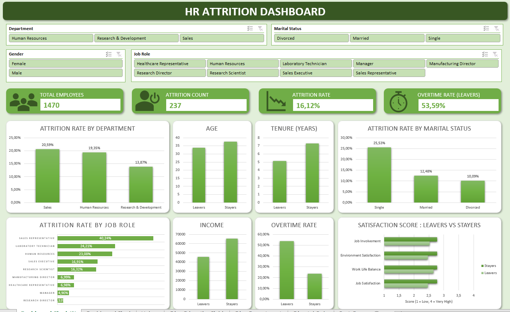
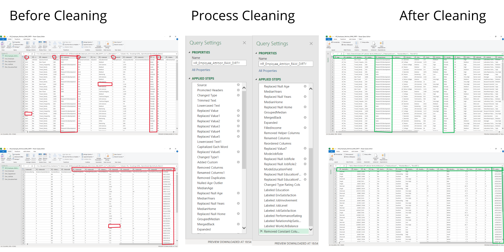

# Employee Attrition & Performance Analysis (Excel)

Analisis end-to-end employee attrition menggunakan **Excel** (Power Query, Power Pivot, DAX, PivotTable), mulai dari data mentah yang kotor sampai dashboard interaktif dan rekomendasi bisnis.



---

## Daftar Isi

1. [Project Overview](#1-project-overview)
2. [Dataset](#2-dataset)
3. [Data Cleaning Process](#3-data-cleaning-process)
4. [Data Modeling & DAX](#4-data-modeling--dax)
5. [Dashboard](#5-dashboard)
6. [Key Findings & Recommendations](#6-key-findings--recommendations)
7. [Tools & Skills Used](#7-tools--skills-used)
8. [Struktur Repository](#8-struktur-repository)

---

## 1. Project Overview

Employee attrition menimbulkan biaya besar bagi perusahaan: rekrutmen ulang, onboarding, hilangnya produktivitas, dan hilangnya pengetahuan internal. Dari 1.470 karyawan dalam dataset, **237 orang (16,1%)** keluar dari perusahaan, namun belum jelas di segmen mana masalahnya paling terasa dan faktor apa yang berasosiasi dengan keputusan tersebut.

**Tujuan analisis:** menemukan pola karyawan yang cenderung keluar agar HR dapat merancang strategi retensi yang proaktif dan tepat sasaran.

> **Catatan framing:** dataset mencatat seluruh bentuk attrition secara umum tanpa membedakan alasan keluarnya (resign, pensiun, dll). Analisis ini bersifat preventif untuk retensi, bukan evaluasi kinerja individu untuk pemecatan.

Pertanyaan analisis disusun dalam 4 level, dari umum ke spesifik:

| Level | Pertanyaan |
|---|---|
| 1. Skala masalah | Seberapa besar attrition rate secara keseluruhan? |
| 2. Segmentasi | Di department / job role mana masalahnya paling terasa? |
| 3. Profil pembanding | Apa yang membedakan karyawan yang keluar (Leavers) dari yang bertahan (Stayers)? |
| 4. Kondisi kerja | Apakah overtime, kepuasan kerja, dan jarak rumah berasosiasi dengan attrition? |

## 2. Dataset

- **Sumber:** [IBM HR Analytics Employee Attrition & Performance (Kaggle)](https://www.kaggle.com/datasets/pavansubhasht/ibm-hr-analytics-attrition-dataset)
- **Ukuran asli:** 1.470 baris, 35 kolom
- **Cakupan atribut:** demografis (Age, Gender, MaritalStatus), karir (Department, JobRole, YearsAtCompany, TotalWorkingYears), kompensasi (MonthlyIncome, PercentSalaryHike), dan persepsi kerja (JobSatisfaction, WorkLifeBalance, dll)
- **Data sengaja dikotori** menggunakan Python (Google Colab) menjadi `HR_Employee_Attrition_RAW_DIRTY.csv` (1.485 baris) dengan duplikat, missing value, format tidak konsisten, dan outlier, agar proses cleaning dapat didemonstrasikan

> **Catatan:** dataset tidak mencantumkan mata uang untuk `MonthlyIncome`, sehingga nilai income pada analisis ini diperlakukan sebagai unit generik.

## 3. Data Cleaning Process

Seluruh proses dikerjakan di **Power Query** dalam 13 langkah:

| # | Langkah | Detail |
|---|---|---|
| 1 | Import & promote headers | Import CSV, baris pertama dijadikan header |
| 2 | Fix locale numerik | Age, DistanceFromHome, YearsAtCompany diparse dengan locale `en-US` |
| 3 | Standardisasi teks | Department dan Gender: varian huruf besar/kecil dan singkatan dinormalisasi |
| 4 | Bersihkan MonthlyIncome | Hapus prefix "Rp ", convert ke Number |
| 5 | Parse JoinDate | 4 format tanggal campur ditangani dengan `try...otherwise` |
| 6 | Hapus duplikat | Berdasarkan EmployeeNumber (1.485 → 1.470 baris) |
| 7 | Outlier Age | Nilai tidak wajar (540) di-null-kan, bukan menghapus barisnya |
| 8 | Imputasi numerik | Age, YearsAtCompany, DistanceFromHome diisi **median** |
| 9 | Imputasi MonthlyIncome | Diisi **median per JobRole** (grouped) |
| 10 | Imputasi kategorikal | Department, JobRole, EducationField diisi **mode** (menangani `null` dan empty string `""`) |
| 11 | Reorder kolom | Penataan ulang urutan kolom |
| 12 | Labelling kategori | 8 kolom ordinal diubah dari angka 1-5 ke label teks sesuai kamus dataset |
| 13 | Drop kolom konstan | EmployeeCount, StandardHours, Over18 |

**Keputusan kunci:**
- **Median dipilih di atas mean** untuk imputasi karena tahan terhadap outlier dan skewness.
- **Outlier di-null-kan, bukan dihapus barisnya,** agar record karyawan tetap utuh.
- **Median per grup untuk MonthlyIncome** karena income sangat bergantung pada JobRole.

Setelah cleaning, dilakukan **descriptive statistics** (Count, Mean, Std Dev, Min, Max, Quartile) pada 15 variabel numerik menggunakan Excel Analysis ToolPak.



## 4. Data Modeling & DAX

### Star Schema

Flat table dipecah menjadi 1 fact table dan 3 dimension table di Power Query, lalu dihubungkan lewat relationship one-to-many di Power Pivot.


**Alasan desain:**
- Kolom dijadikan dimension table jika nilainya berulang, jumlah unique value cukup banyak, dan kemungkinan besar dipakai sebagai slicer (Department, JobRole, EducationField).
- Gender, MaritalStatus, BusinessTravel, dan OverTime tetap di fact table karena variasinya sedikit (binary atau 3 nilai), sehingga normalisasi tidak memberi manfaat nyata.
- 8 kolom ordinal disimpan sebagai **label teks** agar mudah dibaca di dashboard. Konsekuensinya, perhitungan rata-rata skor memerlukan `SWITCH()` di DAX.

### DAX Measures

Contoh measure yang digunakan:

```dax
Headcount = COUNTROWS(Fact_Employee)

Attrition Count =
CALCULATE(COUNTROWS(Fact_Employee), Fact_Employee[Attrition] = "Yes")

Attrition Rate = DIVIDE([Attrition Count], [Headcount], 0)

Avg Income Leavers =
CALCULATE(AVERAGE(Fact_Employee[MonthlyIncome]), Fact_Employee[Attrition] = "Yes")

Avg Job Satisfaction Score =
AVERAGEX(
    Fact_Employee,
    SWITCH(
        Fact_Employee[JobSatisfaction],
        "Low", 1, "Medium", 2, "High", 3, "Very High", 4,
        BLANK()
    )
)

Overtime Rate Leavers =
CALCULATE(
    COUNTROWS(Fact_Employee),
    Fact_Employee[Attrition] = "Yes",
    Fact_Employee[OverTime] = "Yes"
) / [Attrition Count]
```

Total ada sekitar 40 measure yang disusun mengikuti 4 level pertanyaan analisis, termasuk pasangan measure **Leavers vs Stayers** untuk Age, Tenure, Income, Total Working Years, Years in Current Role, Salary Hike, Distance From Home, dan 4 skor kepuasan.

> **Catatan locale:** pada Excel dengan regional setting Indonesia, separator argumen DAX harus berupa titik koma (`;`), bukan koma (`,`).

## 5. Dashboard

Dashboard satu halaman dengan alur baca dari ringkasan ke detail:

| Bagian | Isi |
|---|---|
| KPI Cards | Total Employees, Attrition Count, Attrition Rate, Overtime Rate (Leavers) |
| Segmentasi | Attrition Rate by Department dan by Job Role |
| Profil pembanding | Age, Tenure, Income (Leavers vs Stayers), Attrition Rate by Marital Status |
| Kondisi kerja | Overtime Rate dan Satisfaction Score (skala 1-4) Leavers vs Stayers |
| Interaktivitas | Slicer: Department, Job Role, Gender, Marital Status |


## 6. Key Findings & Recommendations

### Hasil Utama

- **Attrition rate keseluruhan: 16,1%** (237 dari 1.470 karyawan)
- **Department tertinggi:** Sales (20,6%), diikuti Human Resources (19,4%) dan Research & Development (13,9%)
- **Job role tertinggi:** Sales Representative (40,2%), jauh di atas role lain

| Metrik | Leavers | Stayers |
|---|---|---|
| Rata-rata usia | 33,8 tahun | 37,5 tahun |
| Rata-rata tenure | 5,1 tahun | 7,3 tahun |
| Rata-rata total pengalaman kerja | 8,2 tahun | 11,9 tahun |
| Rata-rata monthly income | 45.862 | 65.314 |
| Overtime rate | 53,6% | 23,4% |
| Rata-rata percent salary hike | 15,10% | 15,23% |

### Insight

1. **Profil karyawan paling rentan:** lebih muda, berada di fase awal karir (tenure dan total pengalaman lebih rendah), dengan income sekitar 30% lebih rendah dibanding yang bertahan.
2. **Overtime adalah sinyal terkuat:** karyawan yang keluar memiliki tingkat lembur lebih dari 2x lipat dibanding yang bertahan (53,6% vs 23,4%).
3. **Sales Representative adalah titik kritis** dengan attrition rate 40,2%, kemungkinan berkaitan dengan tekanan target penjualan dan beban kerja yang tinggi.
4. **Karyawan Single memiliki attrition rate 25,5%,** sedangkan Married dan Divorced sekitar 10-12%.
5. **Temuan yang berlawanan dengan asumsi awal:** persentase kenaikan gaji dan waktu sejak promosi terakhir tidak berbeda signifikan antara Leavers dan Stayers. Level income absolut tampaknya lebih berpengaruh daripada laju kenaikannya.

### Rekomendasi

1. Evaluasi beban kerja dan kebijakan lembur, terutama di Department Sales dan role Sales Representative.
2. Perkuat program retensi untuk karyawan di fase awal karir (mentoring, career path yang jelas, check-in berkala).
3. Tinjau struktur kompensasi untuk role dan level dengan income relatif rendah.
4. Rancang program dukungan khusus untuk karyawan berstatus Single.
5. Lakukan survei kepuasan kerja berkala di segmen dengan attrition tinggi.
6. Fokuskan strategi kompensasi pada level income absolut, bukan hanya laju kenaikan gaji tahunan.

> **Keterbatasan:** seluruh temuan bersifat asosiatif (korelasional), bukan kausal. Diperlukan analisis lanjutan, misalnya exit survey atau model prediktif, sebelum dijadikan dasar kebijakan yang mengikat.

## 7. Tools & Skills Used

**Tools:** Microsoft Excel (Power Query, Power Pivot, DAX, PivotTable, PivotChart, Slicer, Analysis ToolPak), Python / Google Colab (membuat versi dataset yang dikotori)

**Skills:**
- Data cleaning dan ETL dengan Power Query (M code)
- Data modeling (star schema, relationship)
- DAX measures
- Descriptive statistics
- Dashboard design dan data visualization
- Business insight writing dan rekomendasi berbasis data

## 8. Struktur Repository

```
.
├── README.md
├── data/
│   ├── HR_Employee_Attrition_RAW_DIRTY.csv
│   └── hr_employee_analytics.xlsx
├── preprocessing/
│   ├── before_cleaning
│   └── process_cleaning
|   └── after_cleaning
└── images/
    ├── dashboard_full.png
    └── cleaning_before_after.png
```

---

*Dataset: IBM HR Analytics Employee Attrition & Performance (Kaggle). Project ini dibuat untuk keperluan portofolio.*
